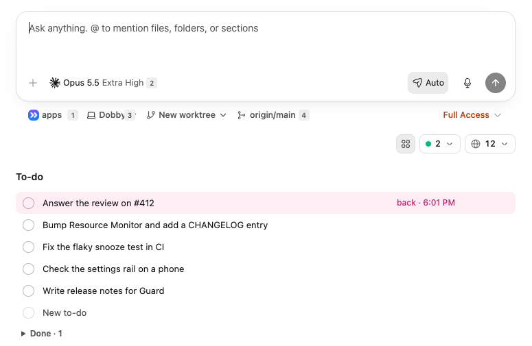
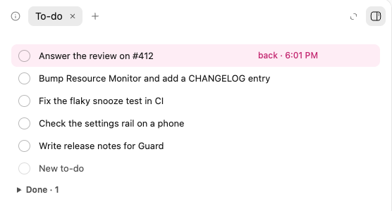

# To-do

To-do keeps a Notes-style to-do list right under the composer on the New
thread screen, and in a **To-do** tab in the right panel, in an open thread
too. Each to-do is a round checkbox and a line of text, and any of them can
start a thread.



## Use

- **Add a to-do**: type in the empty row at the end of the list. **Enter**
  adds the next one; **Backspace** on an empty one removes it.
- **Sort**: drag a to-do by its handle.
- **Check it off**: click its checkbox. The to-do moves to **Done**, a list
  that expands below. Uncheck a to-do there to bring it back; **Clear** empties
  the list.
- **Snooze**: snooze a to-do until later today, tomorrow, the weekend, next
  week, or a date and time you pick. It hides under **Snoozed** and comes back
  at the top of the list, highlighted, when its time comes.
- **Start a thread**: click a to-do's arrow button. Its text goes into the New
  thread composer.
- **Open the tab**: choose **To-do** from the right panel's **+** menu, on the
  New thread screen or in an open thread.



## How it works

- The to-dos live in the plugin's SQLite database on the BB server
  (`<bb data dir>/plugins/todo/data.db`). There is one list for the whole
  server, so desktop and phone show the same to-dos, and a change in one
  window shows in the others at once.
- A BB update may break the list's placement, which relies on BB's
  `plugin-homepage-sections` markup to put the list right under the composer,
  or the SDK's `experimental_tab`, `experimental_newThreadPanelAction`,
  `experimental_Icon`, and `experimental_PluginRpcRefusal`.

## Install

Needs BB 0.47.0 or later.

```sh
bb marketplace add git:https://github.com/rebryk/bb-plugins.git@main
bb plugin install todo@sf-plugins
```

Use `bb plugin install .` from this directory instead when working on it
locally.

## Development

```sh
npm ci
npm test
npm run typecheck
npm run build
bb plugin reload todo
```

## More San Francisco Plugins

To-do is one of the
[San Francisco Plugins](https://github.com/rebryk/bb-plugins), a family of BB
plugins. The others:

- [Superhuman](../superhuman): Superhuman-style speed for BB, with shortcuts and
  search in any keyboard layout, snoozed threads, and a phone layout.
- [Bookmarks](../bookmarks): save any chat message and jump back to it from the
  thread's right panel.
- [Canvas](../canvas): images, text, and drawing in each thread, with
  screenshots your agent can read.
- [Annotate](../annotate): notes on the elements of a page in BB's Browser,
  sent to your agent with a screenshot.
- [Auto Update](../auto-update): updates for the plugins you pick, installed
  every hour, day, or week.
- [Storage Cleaner](../storage-cleaner): what fills your Mac's disk, and
  cleanup of archived threads, worktrees, and caches.
- [Resource Monitor](../resource-monitor): live CPU, RAM, and GPU bars for the
  BB server in the sidebar, with the numbers on hover.
- [San Francisco](../san-francisco): a quiet macOS-style theme after the Aside
  browser, with your pick of the eight macOS accent colors.
- [Pool Usage](../pool-usage): how much of each provider's capacity is in use
  and when it frees up, in the sidebar footer.
